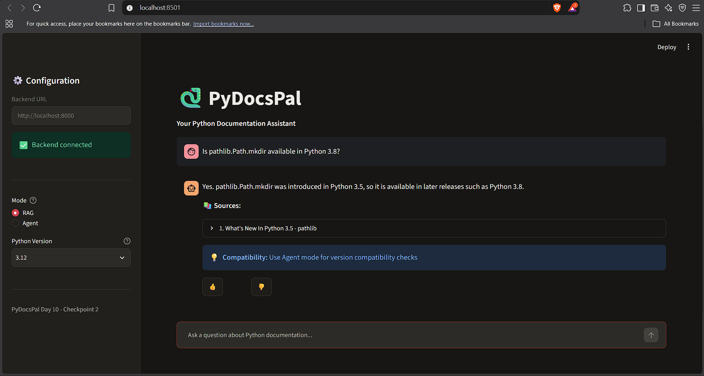

# PyDocsPal

### Your Python Documentation Assistant

PyDocsPal is a Python documentation assistant designed to help developers and students discover and understand Python modules, functions, classes, signatures, usage examples, and version compatibility using official Python documentation.

## Project Overview

**Problem:** Finding accurate Python API information, understanding function usage, checking version compatibility, and identifying deprecated features can take time.

**Solution:** PyDocsPal collects and organizes Python documentation into searchable records and text chunks. It provides keyword-based, semantic, and hybrid search through a FastAPI service, with an LLM-powered explanation endpoint.

**Primary Data Source:** [Official Python Documentation](https://docs.python.org/3/)

## Core Features

- Search Python functions, modules, and classes.
- Retrieve API signatures and usage examples.
- Search structured documentation records using TF-IDF.
- Split documentation into manageable text chunks.
- Generate embeddings using Sentence Transformers.
- Store and retrieve document embeddings using ChromaDB.
- Perform semantic search across documentation chunks.
- Combine semantic and lexical search using Reciprocal Rank Fusion (RRF).
- Generate explanations using an LLM provider.
- Access functionality through REST API endpoints.
- Analyze structured documentation records using Pandas.
- **NEW - Day 10:** Interactive Streamlit UI with chat interface.
- **NEW - Day 10:** Python version compatibility badges and deprecation warnings.
- **NEW - Day 10:** User feedback system with persistent storage.
- **NEW - Day 10:** Multi-step agent mode with human approval workflow.

## Tech Stack

| Category | Technologies |
|---|---|
| Language | Python |
| API | FastAPI, Uvicorn |
| Frontend | **Streamlit** |
| Data Processing | Pandas |
| Keyword Search | Scikit-learn, TF-IDF |
| Semantic Search | Sentence Transformers |
| Embedding Model | all-MiniLM-L6-v2 |
| Vector Database | ChromaDB |
| Ranking | Cosine Similarity, Reciprocal Rank Fusion |
| LLM Integration | Groq / Gemini provider wrapper |
| Agent Framework | **LangGraph** |
| Data Storage | JSON, Text Files, **SQLite** |
| Environment Management | python-dotenv, venv |
| Version Control | Git, GitHub |

## Project Structure

```text
PyDocsPal/
│
├── analysis/
│   ├── __init__.py
│   └── explore.py
│
├── app/
│   ├── __init__.py
│   ├── main.py
│   ├── records.py
│   ├── smart_search.py
│   ├── chunking.py
│   ├── embed.py
│   ├── vectorstore.py
│   ├── hybrid_search.py
│   ├── llm.py
│   ├── cli.py
│   ├── ingest.py
│   ├── models.py
│   ├── fetch.py
│   ├── rag.py
│   ├── agent_loop.py
│   ├── graph.py
│   └── tools.py
│
├── ui/
│   └── app.py
│
├── data/
│   ├── raw/
│   │   ├── extracted/
│   │   └── fetched/
│   ├── chroma_db/
│   ├── records.json
│   ├── stdlib_versions.csv
│   └── feedback.db
│
├── docs/
│   ├── how_llms_work.md
│   ├── user_questions.md
│   └── screenshots/
│       └── checkpoint-2.png
│
├── prompts/
│   ├── system.txt
│   ├── task_explain.txt
│   └── task_compare.txt
│
├── eval/
│   ├── run_search_eval.py
│   ├── run_hybrid_eval.py
│   ├── search_results.md
│   └── hybrid_search_results.md
│
├── tests/
│   └── test_streamlit_integration.py
│
├── day01_intro.py
├── day01_menu.py
├── README.md
├── requirements.txt
├── .env.example
└── .gitignore
```

*Note: Generated files and local environment files may not be included in the Git repository.*

## Installation and Setup

### 1. Clone the repository

```bash
git clone https://github.com/111-amann/CreamAI.git
cd CreamAI
```

### 2. Create a virtual environment

```bash
python -m venv .venv
```

### 3. Activate the environment

Windows PowerShell:

```powershell
.venv\Scripts\Activate.ps1
```

### 4. Install dependencies

```bash
pip install -r requirements.txt
```

### 5. Configure environment variables

Create a `.env` file in the project root.

Example Groq configuration:

```env
LLM_PROVIDER=groq
GROQ_API_KEY=your_groq_api_key
GROQ_MODEL=openai/gpt-oss-120b
```

Use your own API key. Never commit `.env` or expose API credentials in GitHub.

### 6. Run the CLI application

```bash
python -m app.cli
```

### 7. Start the FastAPI server

```bash
uvicorn app.main:app --reload
```

The API will be available at:

`http://127.0.0.1:8000`

Interactive Swagger documentation:

`http://127.0.0.1:8000/docs`

## Documentation Processing and Indexing

PyDocsPal uses documentation text files as its retrieval corpus.

The processing pipeline includes:

1. Fetching documentation pages.
2. Extracting documentation text.
3. Splitting documents into chunks while retaining source and section metadata.
4. Generating embeddings with Sentence Transformers.
5. Storing embeddings and metadata in a persistent ChromaDB collection.

To fetch the configured documentation pages:

```bash
python -m app.fetch
```

To run the structured-record ingestion process:

```bash
python -m app.ingest
```

To build or rebuild the ChromaDB index:

```bash
python -m app.vectorstore
```

The persistent ChromaDB database is stored locally in:

`data/chroma_db/`

The first embedding-model load may require an internet connection to download the model.

## Search Architecture

PyDocsPal currently provides three different retrieval approaches.

### 1. Structured Record Search

The `smart_search.py` module uses:

- **TF-IDF:** Converts text into numerical representations based on word importance.
- **Cosine Similarity:** Measures similarity between the query and documentation records.
- **Ranking:** Returns the highest-scoring records.

This search operates on the structured records in `data/records.json`.

### 2. Semantic Search

The semantic retrieval pipeline uses:

- **Chunking:** Divides documentation into smaller text segments.
- **Sentence Transformers:** Generates 384-dimensional embeddings using `all-MiniLM-L6-v2`.
- **ChromaDB:** Stores and retrieves document embeddings.
- **Similarity Search:** Retrieves chunks based on semantic similarity.

### 3. Hybrid Search

The hybrid search module combines:

- Semantic retrieval from ChromaDB.
- Lexical retrieval using TF-IDF.
- Reciprocal Rank Fusion (RRF) to combine the two rankings.

This approach aims to improve retrieval by considering both meaning and exact terminology.

**Important:** Hybrid retrieval improves the available search signals, but it does not guarantee that every query will retrieve complete or correct documentation.

## LLM Integration

PyDocsPal includes an LLM provider wrapper that supports configured providers such as Groq and Gemini.

The `/chat` endpoint:

1. Accepts a user question.
2. Retrieves relevant structured documentation records.
3. Loads the system and task prompts.
4. Sends the prompt and retrieved context to the configured LLM.
5. Returns a structured response containing an answer, confidence value, and follow-up question.

The confidence value is model-reported and is not a calibrated probability.

## API Endpoints

| Method | Endpoint | Description |
|---|---|---|
| GET | `/health` | Check API health |
| GET | `/records?limit=10` | Retrieve structured records |
| GET | `/records/{id}` | Retrieve a record by ID |
| GET | `/search?q=python` | Search structured records using TF-IDF |
| GET | `/search/semantic?q=python` | Search documentation chunks using hybrid retrieval |
| POST | `/questions` | Retrieve relevant structured records for a question |
| POST | `/chat` | Generate an LLM-powered response using structured-record context |
| POST | `/ask` | Full RAG: Grounded answer with verified citations and evidence-based abstention |

### Example: Hybrid Search

**GET**

```http
/search/semantic?q=pathlib.Path.read_text%20signature&limit=5
```

Example response structure:

```json
{
  "query": "pathlib.Path.read_text signature",
  "search_type": "hybrid",
  "total_results": 5,
  "results": [
    {
      "id": "document_chunk_id",
      "text": "Relevant documentation text...",
      "source": "path/to/document.txt",
      "title": "Pathlib",
      "section": "Reading and writing files",
      "page": "unknown",
      "hybrid_score": 0.031,
      "semantic_rank": 4,
      "lexical_rank": 2
    }
  ]
}
```

*The values above illustrate the response structure, not a fixed search result.*

### Example: Chat

**POST `/chat`**

Request body:

```json
{
  "question": "Explain pathlib.Path.read_text",
  "task": "explain"
}
```

The response contains:

- `answer`
- `confidence`
- `follow_up`

### Example: Grounded RAG (`/ask`)

**POST `/ask`**

Request body:

```json
{
  "question": "What is the signature of pathlib.Path.read_text?",
  "top_k": 5
}
```

Response structure:

```json
{
  "question": "What is the signature of pathlib.Path.read_text?",
  "answer": "Path.read_text(encoding=None, errors=None, newline=None)",
  "status": "answered",
  "citations": [
    {
      "source": "data/raw/extracted/python-3.15-docs-text/library/pathlib.txt",
      "title": "pathlib --- Object-oriented filesystem paths",
      "section": "Reading and writing files",
      "page": "unknown"
    }
  ]
}
```

For questions unsupported by the documentation corpus, evidence-based abstention returns `status: "insufficient_evidence"`, `answer: "I don't know"`, and `citations: []`.

## Evaluation

PyDocsPal includes evaluation scripts for comparing semantic and hybrid retrieval.

Run semantic search evaluation:

```bash
python -m eval.run_search_eval
```

Run hybrid search evaluation:

```bash
python -m eval.run_hybrid_eval
```

Evaluation reports:

- `eval/search_results.md` (Semantic retrieval evaluation)
- `eval/hybrid_search_results.md` (Day 7 hybrid retrieval evaluation)
- `eval/eval_comparison.md` (Day 8 RAG benchmark comparison)
- `eval/eval_results_config_a.json` (Config A detailed results)
- `eval/eval_results_config_b.json` (Config B detailed results)

### Day 8 RAG Benchmark Comparison (Config A vs Config B)

Run the full automated benchmark:

```bash
python -m eval.run_eval
```

Benchmark results across 15 ground-truth evaluation questions (14 answerable questions covering signatures, behavior, release notes, and module discovery; 1 unanswerable question testing evidence-based abstention):

| Metric | Denominator | Config A (1800 chars, top-5) | Config B (1200 chars, top-8) | Assessment / Comparison |
|---|:---:|:---:|:---:|:---:|
| **ChromaDB Collection** | - | `pydocspal_docs` (21,012 chunks) | `pydocspal_docs_c1200_o250` (34,633 chunks) | Isolated collections |
| **Source Retrieval Rate** | 14 answerable | 92.9% (13/14) | 92.9% (13/14) | Tied |
| **Evidence Retrieval Rate** | 14 answerable | 85.7% (12/14) | 85.7% (12/14) | Tied |
| **Answer Correctness Rate** | 15 total | 60.0% (9/15) | 60.0% (9/15) | Tied |
| **Expected Source Citation Rate** | 15 total | 60.0% (9/15) | 60.0% (9/15) | Tied |
| **Correct Abstention Rate** | 1 unanswerable | 100.0% (1/1) | 100.0% (1/1) | Tied (Both strictly abstain on Q14) |
| **False Abstention Rate** | 14 answerable | 28.6% (4/14) | 35.7% (5/14) | Config A lower (4 vs 5 false abstentions) |
| **Unsupported Answer Rate** | 15 total | 13.3% (2/15) | 6.7% (1/15) | Config B lower (1 vs 2 unsupported) |
| **Avg Retrieval Latency** | 15 total | **1.115s** | 1.228s | Config A slightly faster (-0.113s) |
| **Avg Total Latency** | 15 total | **11.341s** | 15.768s | Config A faster (-4.428s, fewer context tokens) |

**Overall Assessment**:
1. **Parity in Answer Correctness**: When ground truth is verified against the official documentation (confirming that Q6 is answerable from `whatsnew/3.15.txt`), both configurations achieve identical overall answer correctness (9/15 = 60.0%). There is no definitive overall winner based solely on answer correctness.
2. **Source vs Evidence Retrieval Gap**: While both configurations achieve a high Source Retrieval Rate (92.9%), the Evidence Retrieval Rate is 85.7% (and drops on multi-fact queries such as Q1 and Q6). Retrieving a relevant document chunk does not guarantee that the exact needed sentence or class inventory is present.
3. **Expected Source Citation Rate**: The 60.0% rate reflects whether citations point to expected documentation files (or are properly empty for unanswerable queries). It does not certify full semantic entailment of every generated claim.
4. **Abstention Trade-offs**: Both configurations correctly abstain on fictitious queries (Q14) with 100% precision. Config A is more prone to generating answers from adjacent context (e.g. Q6 changelog extrapolation), while Config B is more conservative, yielding slightly higher false abstentions (35.7% vs 28.6%) but fewer unsupported substantive answers (6.7% vs 13.3%).
5. **Latency Profile**: Config A is significantly faster in end-to-end latency (11.34s vs 15.77s) because passing 5 chunks (1800 chars) introduces fewer tokens to the remote LLM than passing 8 chunks (1200 chars).

## LLM Concepts and Learning Documentation

The project also includes learning material covering:

- Large Language Models.
- Tokenization and embeddings.
- Transformer architecture and attention.
- Next-token prediction.
- Prompt engineering.
- LLM limitations and hallucinations.
- Retrieval-Augmented Generation concepts.

See [`docs/how_llms_work.md`](docs/how_llms_work.md).

## Day 10: Streamlit UI + Checkpoint 2

### Overview

Day 10 introduces a professional Streamlit frontend that integrates with the existing FastAPI backend. The UI provides an interactive chat interface with Python compatibility checking, citations, and user feedback collection.



### Features

#### 1. **Chat Interface**
- Clean, professional chat UI using `st.chat_message()` and `st.chat_input()`
- Conversation history maintained in session state
- Loading indicators for backend responses
- Error handling for backend connectivity issues

#### 2. **Dual Operating Modes**

**RAG Mode:**
- Direct question answering via `/ask` endpoint
- Displays generated answer with supporting citations
- Fast responses for straightforward documentation queries

**Agent Mode:**
- Multi-step reasoning via `/agent` endpoint with LangGraph
- Automatic tool selection (RAG search, version checking)
- Human approval workflow for proposed actions
- Resume capability for interrupted conversations

#### 3. **Python Compatibility Badges** ⭐ *Signature Feature*

Every assistant answer displays compatibility information:

- **✅ Works from Python X.Y** - Shows minimum required Python version
- **⚠️ Deprecated since Python X.Y** - Warning for deprecated APIs
- **❌ Removed in Python X.Y** - Error for removed APIs
- **💡 Compatibility unknown** - When version data is unavailable

The system:
- Extracts API names from assistant responses
- Uses the `stdlib_version_check` tool from Day 9
- Displays evidence from official documentation
- Links to exact documentation sections when available
- Never invents compatibility information

#### 4. **Citations Display**

All answers include supporting documentation sources:
- Source filename and title
- Documentation section
- Expandable details using Streamlit expanders
- Clear indication when no citations are available

#### 5. **User Feedback System**

Every response includes thumbs up/down controls:
- Feedback persisted to SQLite database (`data/feedback.db`)
- Stores question, answer, feedback value, timestamp, Python version, and mode
- Prevents duplicate feedback submissions
- Shows confirmation when feedback is saved

#### 6. **Configuration**

Sidebar settings include:
- Backend URL display
- Mode selection (RAG vs Agent)
- Python version selector (3.8 through 3.15)
- Backend health indicator

Environment variables:
- `PYDOCSPAL_API_URL` - Backend URL (default: `http://localhost:8000`)

### Installation and Usage

#### Install Streamlit Dependencies

```bash
pip install streamlit>=1.40.0
```

**Note:** There may be protobuf version conflicts between streamlit and chromadb. Install with:

```bash
pip install --no-deps streamlit==1.40.2
```

#### Start the Backend

```bash
python -m uvicorn app.main:app --host 0.0.0.0 --port 8000
```

#### Start the Streamlit UI

```bash
streamlit run ui/app.py
```

The Streamlit app will be available at:
- Local: `http://localhost:8501`
- Network: Check terminal output for network URL

#### Using the Application

1. **Select Mode:** Choose between RAG or Agent mode in the sidebar
2. **Select Python Version:** Pick your target Python version for compatibility checks
3. **Ask Questions:** Type your question in the chat input
4. **Review Answers:** See the response with citations and compatibility badges
5. **Approve Actions (Agent Mode):** Review and approve/reject proposed agent actions
6. **Provide Feedback:** Use thumbs up/down to rate responses

### Example Interactions

**RAG Mode Query:**
```
User: What is pathlib.Path.read_text?
Assistant: Path.read_text(encoding=None, errors=None, newline=None) reads the file...
💡 Compatibility: Use Agent mode for version compatibility checks
📚 Sources: pathlib.txt - Reading and writing files
```

**Agent Mode Query:**
```
User: Is pathlib.Path.mkdir available in Python 3.8?
Assistant: [Performs version check]
✅ Works from Python 3.5
🔍 Detailed Compatibility Information:
  Symbol: pathlib.Path.mkdir
  Status: available
  Introduced in: Python 3.5
  Evidence: Added in version 3.5
📚 Sources: pathlib.txt
```

**Deprecated API Warning:**
```
User: Tell me about os.popen
Assistant: os.popen() executes a command and returns a file object...
⚠️ os.popen - Deprecated since Python 3.13, use subprocess.Popen instead
📚 Sources: os.txt
```

### Testing

Run integration tests:

```bash
python tests/test_streamlit_integration.py
```

Tests verify:
- Backend health check
- RAG endpoint integration
- Agent endpoint integration with approval flow
- Streamlit UI accessibility

### Feedback Database Schema

The SQLite feedback database (`data/feedback.db`) contains:

```sql
CREATE TABLE feedback (
    id INTEGER PRIMARY KEY AUTOINCREMENT,
    question TEXT NOT NULL,
    answer TEXT NOT NULL,
    feedback INTEGER NOT NULL,  -- 1 for thumbs up, -1 for thumbs down
    timestamp TEXT NOT NULL,
    python_version TEXT,
    mode TEXT,  -- 'RAG' or 'Agent'
    answer_hash TEXT UNIQUE  -- Prevents duplicate submissions
);
```

### Architecture

```
┌─────────────────┐
│  Streamlit UI   │
│   (Port 8501)   │
└────────┬────────┘
         │ HTTP
         ▼
┌─────────────────┐
│  FastAPI Server │
│   (Port 8000)   │
├─────────────────┤
│ /ask (RAG)      │
│ /agent (Agent)  │
└────────┬────────┘
         │
    ┌────┴────┐
    ▼         ▼
┌────────┐ ┌─────────────┐
│ChromaDB│ │stdlib_ver... │
│        │ │check (Day 9)│
└────────┘ └──────────────┘
```

### Checkpoint 2 Deliverables

✅ Streamlit UI at `ui/app.py`
✅ RAG mode integration
✅ Agent mode integration with approval workflow
✅ Python compatibility badges
✅ Deprecation/removal warnings
✅ Citations display
✅ User feedback system with SQLite
✅ Integration tests
✅ Updated documentation
✅ Screenshot captured

## Developer

**Aman Sayyad**

[GitHub Profile](https://github.com/111-amann)

---

*Built as part of the Generative AI training program at Sanjivani University.*
