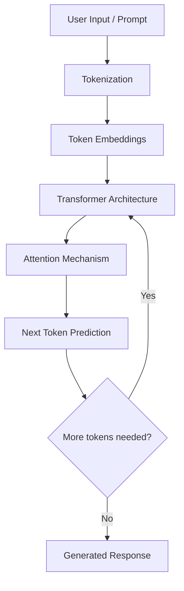

# How Large Language Models (LLMs) Work

## 1. What is an LLM?

A Large Language Model (LLM) is an artificial intelligence model trained on a large amount of text data. It learns patterns in language and uses those patterns to understand prompts and generate human-like text.

Examples of popular LLMs include:
- GPT models by OpenAI
- Gemini by Google
- Claude by Anthropic
- Llama by Meta

LLMs can answer questions, summarize documents, explain code, generate content, and assist with programming.

## 2. How does an LLM work?

An LLM processes text through several stages.

### Step 1: Input and Tokenization

The user provides a prompt or question. The model converts the text into smaller units called tokens.

For example:

"Python is easy to learn."

The tokenizer divides the sentence into tokens. A token can be a complete word, part of a word, or punctuation.

### Step 2: Embeddings

Tokens are converted into numerical representations called embeddings.

These representations help the model process relationships and patterns between words and tokens.

### Step 3: Transformer Architecture

Modern LLMs commonly use the Transformer architecture.

An important component is the Attention Mechanism. It helps the model determine which parts of the input are important in relation to other parts.

For example, in the sentence:

"The developer used Python because it is easy to learn."

The model uses context to understand what "it" refers to.

### Step 4: Prediction

The model calculates probabilities for possible next tokens based on the previous context.

It selects a token and repeats this process to generate a response.

### Step 5: Output Generation

The generated tokens are converted back into readable text and returned to the user.

## 3. LLM Workflow Diagram

## 4. What is the Transformer Architecture?

The Transformer is a neural network architecture used by many modern language models.

Its important concepts include:

- **Attention:** Helps the model focus on relevant parts of the input.
- **Self-Attention:** Allows tokens to relate to other tokens in the same input.
- **Feed-Forward Networks:** Process the representations produced by attention layers.
- **Positional Information:** Helps the model understand the order of tokens.

## 5. What is Prompt Engineering?

Prompt engineering means writing clear instructions and providing relevant context to get more useful responses from an LLM.

Example:

**Weak prompt:**

"Explain Python."

**Better prompt:**

"Explain Python dictionaries to a beginner. Include a simple example and explain each line of code."

The second prompt gives the model a clear task, audience, and expected output.

## 6. LLMs vs Traditional Search

Traditional search techniques such as TF-IDF identify documents using word frequency and similarity.

LLMs generate responses based on patterns learned during training and the context provided in a prompt.

| TF-IDF Search | LLM |
|---|---|
| Finds relevant documents | Generates text responses |
| Uses word importance | Uses learned language patterns |
| Does not generate explanations by itself | Can generate explanations |
| Useful for keyword-based retrieval | Useful for language understanding and generation |

## 7. Limitations of LLMs

LLMs are powerful, but they are not always correct.

Some limitations include:

- They can generate incorrect information.
- They may produce hallucinations.
- Their knowledge may be outdated.
- They can misunderstand ambiguous prompts.
- Their responses depend on the quality of the input and available context.

For technical documentation, important information should be verified against official sources.

## 8. How LLMs Can Be Used in PyDocsPal

PyDocsPal currently uses structured Python documentation records and TF-IDF-based smart search.

In a future version, an LLM can be integrated to:

1. Understand a user's programming question.
2. Retrieve relevant Python documentation records.
3. Use the retrieved records as context.
4. Generate an understandable explanation.
5. Provide documentation references to support the answer.

This approach can be extended using Retrieval-Augmented Generation (RAG).

## Conclusion

LLMs are trained to recognize language patterns and generate responses based on context. They can make PyDocsPal more useful by turning retrieved Python documentation into clear explanations. However, generated answers should be grounded in official documentation to reduce incorrect information.